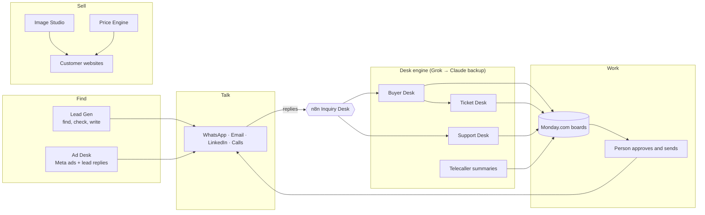

# Architecture

## How the systems connect

Lead Gen and the Ad Desk start conversations. Every reply flows through n8n into the desk engine, which reads it,
decides what it is and how urgent, drafts a reply, and puts a row on Monday with an owner and deadline.
A person approves every reply before it is sent. The Image Studio and Price Engine feed the customer websites.

## Patterns every system shares

| Pattern | How | Why |
|---|---|---|
| **Primary AI + automatic backup** | Grok 4.7 first, 40 s timer (45 s in n8n); on timeout, HTTP error or an unreadable answer, Claude answers instead (2 tries, 2 s apart in n8n) | An AI outage must never stop the desk. Tested live with Grok switched off: Claude answered in about 8 s |
| **Structured outputs** | Both models must return a fixed JSON shape (`MODULES[...].schema`) | Code can trust every field; no parsing guesswork |
| **Rules in code, after the AI** | `applyRules()`, `quality-checks.js`, price sanity limits | An AI can be talked into anything; plain code cannot |
| **Deadlines from code** | Sales 2 h / 24 h / 3 days / 7 days; support 1 h / 4 h / 24 h / 72 h | The AI judges urgency; the business decides what urgency means |
| **Human approval** | Every drafted reply waits for a person; below 70% confidence it is flagged | Replies never go out on their own. Two deliberate exceptions: first-touch email within a daily cap, and the AI telecaller, which says it is an AI |
| **No duplicates** | n8n keeps the IDs of the last 500 messages in its saved workflow data; Monday steps retry one at a time; the image ledger records every paid request | A repeat is skipped in 0 s; no duplicate rows; nothing is paid for twice |
| **Cost control** | Cheapest capable model per job; half-price overnight batches; cached instructions (90% off the repeated part); credit caps; one test item first | Lead Gen: about $12 a month in pay-per-use AI and data, about $236 a month with subscriptions; a ring's 24 pictures + video cost about $1.25 |
| **Secrets** | All keys in environment variables; access codes on every private screen; phone numbers masked in the UI | Nothing sensitive in code or logs |

## Choosing the model for each job

| Job | Model | Reason |
|---|---|---|
| Read, translate and sort thousands of short messages | Grok 4.7 | Fast and cheap; under 1 cent a conversation |
| Backup for the desks | Claude Opus 5.5 | Most reliable; only runs when Grok fails, so its price barely matters |
| Research notes, grading drafts out of 10 | Claude Haiku 4.5 | Simple repeated work: the cheapest model that does it well |
| Writing personal letters, rewriting weak ones, Arabic | Claude Sonnet 5.5 | Words a buyer reads are worth the better writer |
| Ad copy | Claude Opus 5.5 | We pay to show these words |
| Live phone calls | Claude Haiku 4.5 inside ElevenLabs | Fast and follows rules; Sonnet cost 64% more with no better calls |
| Prices | No AI | A price must be exact and the same every time |

## Stack

Claude Code (building) · Grok API · Claude API · n8n (self-hosted) · Monday.com API · Vercel (hosting and
serverless functions) · Supabase (data) · Apify, Jina Reader, Sales Navigator (finding and reading businesses) ·
kie.ai (Nano Banana, Veo) · ElevenLabs (voice) · JavaScript (this repository; the Lead Gen app itself is Next.js with TypeScript, not included), Python.

## Compliance, privacy and AI safety

| Topic | What is in place | What I would add for a US agency |
|---|---|---|
| Opt-outs | "Stop contacting me" makes the message urgent: checked on the original and on the AI's English translation, so other languages are caught as well as the translation allows. In the Lead Gen system (not in this repository), people who ask to stop go on a never-contact list that code checks before every send | An unsubscribe link and footer on every email (CAN-SPAM), and a per-channel opt-out sync with the CRM |
| Calls | The AI telecaller says it is an AI and that the call is recorded; it only calls people who asked to be called | Consent records per number and calling-hour rules per state (TCPA) before any outbound calling |
| Prompt injection | Customer text only ever goes in as data; the AI must answer in a fixed JSON shape; rules in code run after the AI; a person approves every reply, so an injected instruction cannot send anything | A scan for instruction-like text in incoming messages, logged for review |
| Personal data | Keys only in environment variables; phone numbers masked on screen; access codes on every private page; messages are processed by xAI and Anthropic under their API terms | A written data-processing note for clients and a retention limit on stored messages |
| Platforms | WhatsApp and LinkedIn messages are sent by a person at a normal pace | The official WhatsApp Business API for any volume sending |
