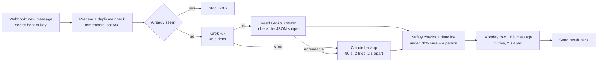

# n8n: SJF Inquiry Desk (live)

Self-hosted n8n 2.48. One workflow is switched on: every buyer reply goes through it. The real workflow is exported in
[`inquiry-desk.workflow.json`](inquiry-desk.workflow.json) (importable into n8n), with only the AI instructions, the board ID and the
account links removed.

| Box | What it does |
|---|---|
| New buyer message | Webhook; a request without the right secret key is refused |
| Prepare and check duplicates | Remembers the last 500 messages; builds the request for the AI |
| Grok sorts it | Reads, translates, sets urgency, drafts the reply; 45 s timer; on error, the error branch goes to Claude |
| Read Grok's answer | Checks the answer is in the fixed shape; a scrambled answer also goes to Claude |
| Backup: Claude | Only runs if Grok is slow, errors or answers wrongly |
| Safety checks and Monday row | Banned claims and under-70% confidence flagged; backup answers flagged; the action set by code from what the buyer wants (send quote, send catalogue, arrange sample, custom design brief, resolve complaint, order or payment, follow up); deadline from urgency (2 h, 24 h, 3 days, 7 days); the owner from a fixed list (director, telecaller, production, export) |
| Add row + full message | Team's Monday board: 11 columns filled (urgency, action, owner, channel, brand, language, country, hot score, hours to act, requirement, next step), then the message, translation and reply added inside |
| Send result back | The caller always gets an answer, even if Monday is down |

Proven live: with Grok switched off, Claude answered in about 8 s; the same message again was skipped in 0 s; a wrong key was refused.

One difference from the website engine: the "stop contacting me" and "cancel" rules run in the engine (`applyRules`), not yet in this
n8n workflow. Adding them to the workflow's safety box is the next change.

Two of them are exported next to this file ([telecaller.workflow.json](telecaller.workflow.json), [ad-desk.workflow.json](ad-desk.workflow.json)). Six more workflows are built and ready (Lead Gen replies every 30 minutes, Meta Ad Desk, AI Telecaller,
Image Studio budget check at 8 pm, gold price alert at 1 pm, morning digest at 9 am), each with the same
Grok-first, Claude-backup pattern.
